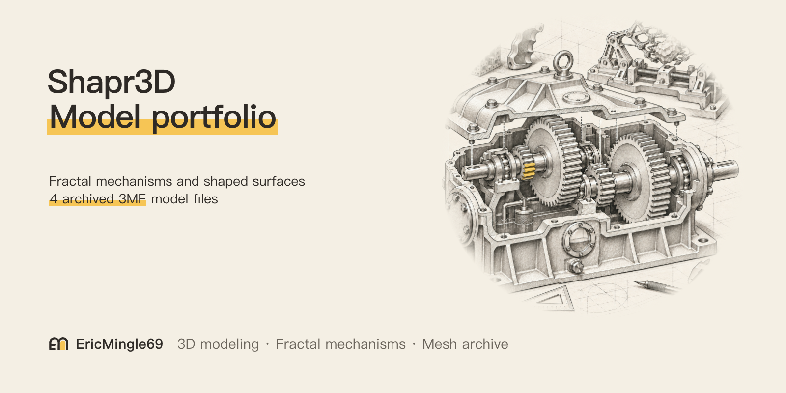
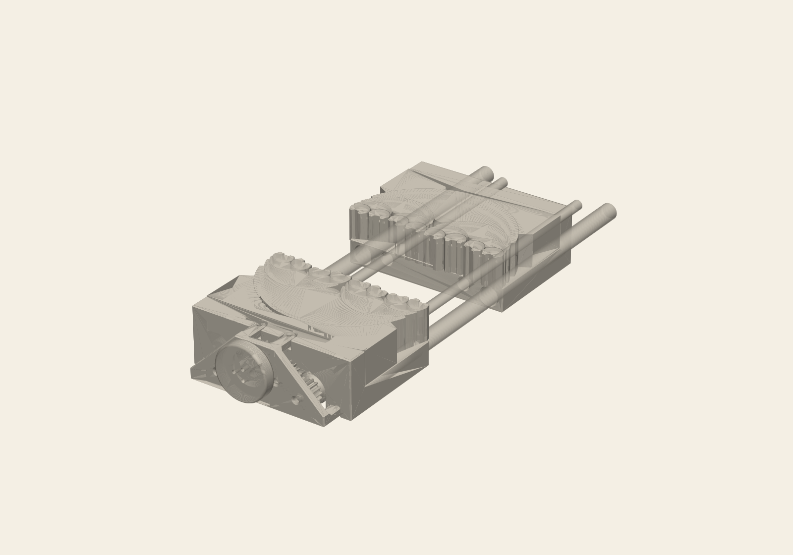

<picture>
  <source media="(prefers-color-scheme: dark)" srcset="readme-assets/cover-en-dark.png">
  
</picture>

<p align="center"><a href="分形虎钳.3mf">Fractal vise</a> · <a href="分形结构.3mf">Fractal structure</a> · <a href="PERSONAL-NOTICE.md">Permissions</a></p>

<p align="center">


</p>

<p align="center"><a href="README.md">简体中文</a> · <b>English</b></p>

# Shapr3D model portfolio

This repository archives four 3MF models: a fractal vise, a fractal structure, a grip-feel improvement design and a soap box. The deliverables are mesh files, with no application source code.

## Overview

| Model | Archived content |
| --- | --- |
| [Fractal vise](分形虎钳.3mf) | Multi-part clamping mechanism |
| [Fractal structure](分形结构.3mf) | Fractal-themed geometry |
| [Grip-feel improvement](手感改善.3mf) | Grip-feel themed form |
| [Soap box](肥皂盒.3mf) | Household product structure |

## Design highlights

- The fractal vise presents a multi-part clamping assembly; the figure below shows its actual mesh.
- The fractal structure and grip-feel model provide separate geometry and form models.
- The cover is an engineering-style illustration of a gear reducer and fractal vise. A reducer file is not included.

## Results

<picture>
  <source media="(prefers-color-scheme: dark)" srcset="readme-assets/vise-dark.png">
  
</picture>

The figure is drawn directly from the triangles in `分形虎钳.3mf`, preserving the stored part positions.

## Method

The project archives Shapr3D modeling files. The available files use the 3MF mesh exchange format; native projects, sketch constraints, parameters and modeling history are absent, so the original modeling steps cannot be reconstructed. Shapr3D documents 3MF among its export formats.<sup>[[1]](#references)</sup>

1. Download a model and import it into a 3MF-compatible viewer or slicer.
2. All four files declare centimeters. Check dimensions and scale after import. Unit fields and mesh structures are read according to the 3MF specification.<sup>[[2]](#references)</sup>
3. Check clearances, mesh integrity, materials and assembly conditions before fabrication or printing.

## Limitations

- The original upload note states that large models were not fully uploaded; scope is limited to the four listed files.
- Modeling software versions, export settings, import compatibility, printability and mechanism performance remain unverified.
- Declared units do not establish physical dimensional accuracy. No load, strength or service-life test data is included.
- Model authorship, provenance and rights to use, modify or redistribute remain unspecified. The documentation license does not cover models.

## Acknowledgements

Thanks to Shapr3D and the 3MF Consortium for software and format documentation. The cover illustration was generated by an image generation model and processed for this project. The model figure was rendered from the repository mesh.

## References

1. Shapr3D. [How to export files from Shapr3D](https://support.shapr3d.com/hc/en-us/articles/7874524196764-How-to-export-files-from-Shapr3D). Software documentation: export formats.
2. 3MF Consortium. [3MF Core Specification, v1.3.0](https://3mf.io/spec/core-v1-3-0/). Format specification: units, resources and triangle meshes.

## Repository structure

```text
├── 分形虎钳.3mf
├── 分形结构.3mf
├── 手感改善.3mf
├── 肥皂盒.3mf
├── README.md / README.en.md
├── PERSONAL-NOTICE.md
└── readme-assets/              Covers, model figures and documentation license
```

---

Documentation maintained by **✦ EricMingle69** · [Ming-Sir-69](https://github.com/Ming-Sir-69)  
[Original documentation: MIT](readme-assets/PERSONAL-DOCUMENTATION-LICENSE.md) · Model license unspecified; see [permissions](PERSONAL-NOTICE.md).
