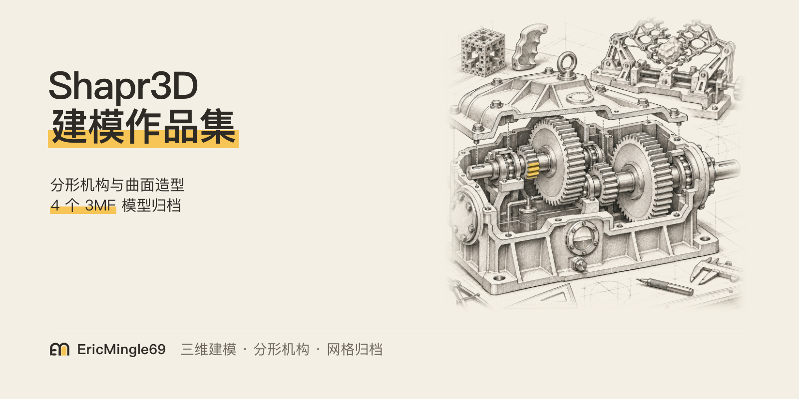
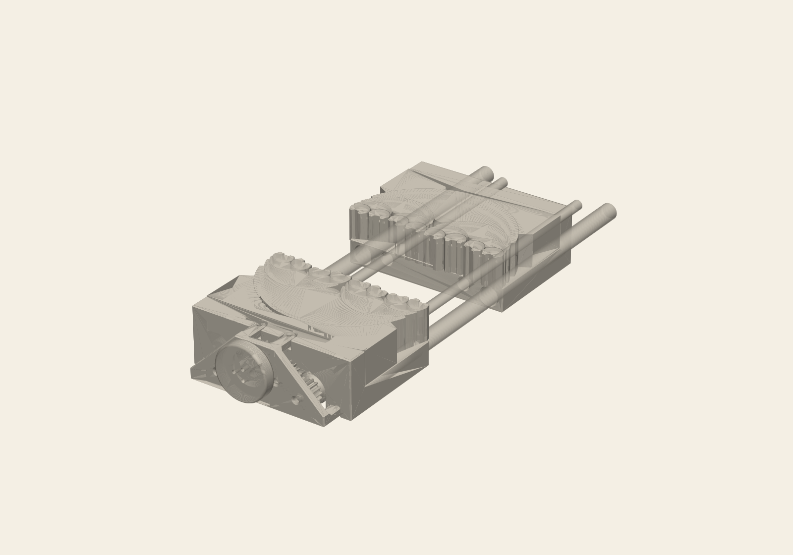

<picture>
  <source media="(prefers-color-scheme: dark)" srcset="readme-assets/cover-zh-dark.png">
  
</picture>

<p align="center"><a href="分形虎钳.3mf">分形虎钳</a> · <a href="分形结构.3mf">分形结构</a> · <a href="PERSONAL-NOTICE.md">许可说明</a></p>

<p align="center">


</p>

<p align="center"><b>简体中文</b> · <a href="README.en.md">English</a></p>

# Shapr3D 建模作品集

本仓库归档分形虎钳、分形结构、手感改善与肥皂盒四个 3MF 模型。当前交付物为网格文件，没有应用源码。

## 概述

| 模型 | 归档内容 |
| --- | --- |
| [分形虎钳](分形虎钳.3mf) | 多零件夹持机构 |
| [分形结构](分形结构.3mf) | 分形主题几何结构 |
| [手感改善](手感改善.3mf) | 手感改善主题造型 |
| [肥皂盒](肥皂盒.3mf) | 日用品结构模型 |

## 设计要点

- 分形虎钳以多零件装配形态呈现夹持机构，正文展示来自该文件的实际网格。
- 分形结构与手感改善分别提供几何结构和造型方向的模型入口。
- 封面采用减速器与分形虎钳的工程风格插画；减速器文件尚未收录。

## 成果展示

<picture>
  <source media="(prefers-color-scheme: dark)" srcset="readme-assets/vise-dark.png">
  
</picture>

上图直接读取 `分形虎钳.3mf` 的三角网格绘制，保留文件内零件位置。

## 方法

本项目以 Shapr3D 建模文件归档为范围。现有文件是 3MF 网格交换格式，未附原生工程、草图约束、参数或建模操作历史，不能据此还原具体建模步骤。Shapr3D 官方文档将 3MF 列为导出格式之一。<sup>[[1]](#参考文献)</sup>

1. 下载所需模型，使用支持 3MF 的查看或切片工具导入。
2. 文件内单位均声明为厘米；导入后仍须核对尺寸与缩放。3MF 的单位字段和网格结构依据格式规范读取。<sup>[[2]](#参考文献)</sup>
3. 加工或打印前，检查零件间隙、网格完整性、材料和装配条件。

## 局限

- 原上传说明指出大型模型未全部上传；当前范围以表中四个文件为准。
- 建模软件版本、导出设置、导入兼容性、可打印性与机构性能未经验证。
- 文件内单位声明不代表尺寸经过实物校准；没有载荷、强度或寿命试验数据。
- 模型作者归属、来源与使用、修改、再分发权限尚未明确；文档许可不覆盖模型。

## 致谢

感谢 Shapr3D 与 3MF Consortium 提供软件及格式文档。封面插画由图像生成模型生成，经本项目处理；正文模型视图由仓库内网格绘制。

## 参考文献

1. Shapr3D. [How to export files from Shapr3D](https://support.shapr3d.com/hc/en-us/articles/7874524196764-How-to-export-files-from-Shapr3D). 软件文档：导出格式。
2. 3MF Consortium. [3MF Core Specification, v1.3.0](https://3mf.io/spec/core-v1-3-0/). 格式规范：单位、资源与三角网格。

## 仓库结构

```text
├── 分形虎钳.3mf
├── 分形结构.3mf
├── 手感改善.3mf
├── 肥皂盒.3mf
├── README.md / README.en.md
├── PERSONAL-NOTICE.md
└── readme-assets/              封面、模型视图与文档许可
```

---

文档维护：<picture><source media="(prefers-color-scheme: dark)" srcset="readme-assets/em-logo-dark.svg"></picture> <b>EricMingle69</b> · <a href="https://github.com/Ming-Sir-69">Ming-Sir-69</a><br>
[文档原创表达：MIT](readme-assets/PERSONAL-DOCUMENTATION-LICENSE.md) · 模型许可未明确，见[许可说明](PERSONAL-NOTICE.md)。
